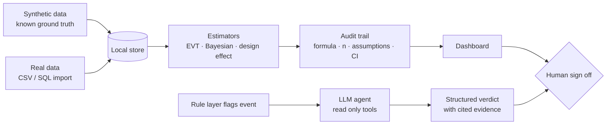
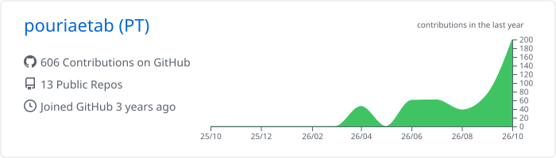
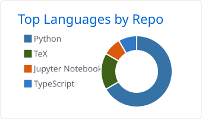

<div align="center">


</div>

---

### About me

```yaml
focus      : statistics · data science · business · product
degree     : M.S. Statistics (Data Science concentration)
experience : autonomous driving · automation · analytics
status     : open to new opportunities · open to relocation
```

- 📊 I turn messy data into clear reports and decisions people can act on
- ⚙️ I build lightweight web apps and automations that take manual work off people's plates

---

<!-- PINNED:START -->
### Pinned

<table>
<tr>
<td width="50%" valign="top">
<a href="https://github.com/pouriaetab/glassbox"><b>📌 glassbox</b></a><br>
<sub>A statistical decision pipeline with its validation, risk gates and failure history rendered live. Built as an engineering demonstration; the measured result is negative.</sub><br><br>

</td>
<td width="50%" valign="top">
<a href="https://github.com/pouriaetab/av-fleet-evt"><b>📌 av-fleet-evt</b></a><br>
<sub>Generation aware extreme value estimation for AV fleet safety validation under heterogeneous sensor generation detection floors. Methods paper plus synthetic simulation.</sub><br><br>

</td>
</tr>
<tr>
<td width="50%" valign="top">
<a href="https://github.com/pouriaetab/tracebench"><b>📌 tracebench</b></a><br>
<sub>A verification and validation reference project: requirements traced to tests, known truth validation, calibration and an offline A/B test, run on live market data as a test bed.</sub><br><br>

</td>
<td width="50%" valign="top">
<a href="https://github.com/pouriaetab/localdeck"><b>📌 localdeck</b></a><br>
<sub>A local control panel to start, stop, watch and open all your local web apps from one browser tab.</sub><br><br>

</td>
</tr>
<tr>
<td width="50%" valign="top">
<a href="https://github.com/pouriaetab/llmledger"><b>📌 llmledger</b></a><br>
<sub>   What happens to an LLM after it is added to LiteLLM&#x27;s price catalogue: competing risks survival analysis of price changes, retirements and removals.</sub><br><br>

</td>
</tr>
</table>

---
<!-- PINNED:END -->

### More projects

<details>
<summary><b>AV safety tools and data science notebooks</b></summary>

<br>

| Project | What it does |
|:--|:--|
| 🛡️ **[av-safety-workbench](https://github.com/pouriaetab/av-safety-workbench)** | Risk assessment workbench where every number carries its method, assumptions, uncertainty and data source. Python + React, runs fully local, 86 tests. |
| 🤖 **[av-safety-triage-agent](https://github.com/pouriaetab/av-safety-triage-agent)** | LLM agent that investigates flagged events with read only tools and proposes a severity for human review, scored against hidden ground truth. |
| 🧰 **[ds-toolkit](https://github.com/pouriaetab/ds-toolkit)** · **[automate-eda](https://github.com/pouriaetab/automate-eda)** | Notebooks on statistical methods, ML and NLP, and a tool that generates EDA notebooks automatically. |

</details>

---

### In the lab (private builds)

- **Control deck.** One local launcher that starts, stops and assigns ports to all my webapps so they never collide.

---

### How I design systems



1. No number without its sample size and its uncertainty.
2. When the evidence is thin, say "insufficient evidence" instead of guessing.
3. Deterministic rules decide what counts. LLMs investigate and explain. People sign off.
4. Test on synthetic data with known answers before trusting real data.
5. Local first. Nothing leaves the machine unless it has to.

---

### Tech stack

**Languages**
<br>


**Statistics and ML**
<br>


**Apps, data and AI**
<br>


**Tools**
<br>


---

### GitHub activity

<div align="center">

<picture>
  <source media="(prefers-color-scheme: dark)" srcset="./profile-summary-card-output/github_dark/0-profile-details.svg">
  
</picture>

<picture>
  <source media="(prefers-color-scheme: dark)" srcset="./profile-summary-card-output/github_dark/1-repos-per-language.svg">
  
</picture>


<picture>
  <source media="(prefers-color-scheme: dark)" srcset="https://raw.githubusercontent.com/pouriaetab/pouriaetab/output/github-snake-dark.svg">
  
</picture>

</div>
